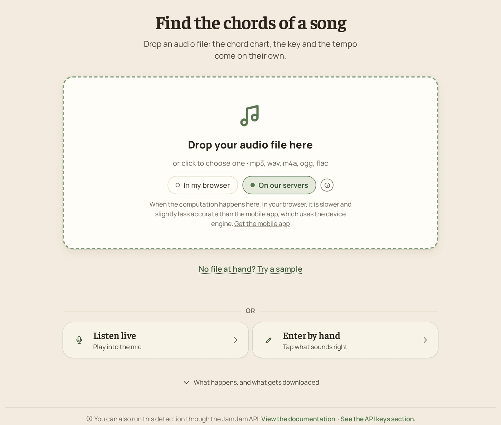
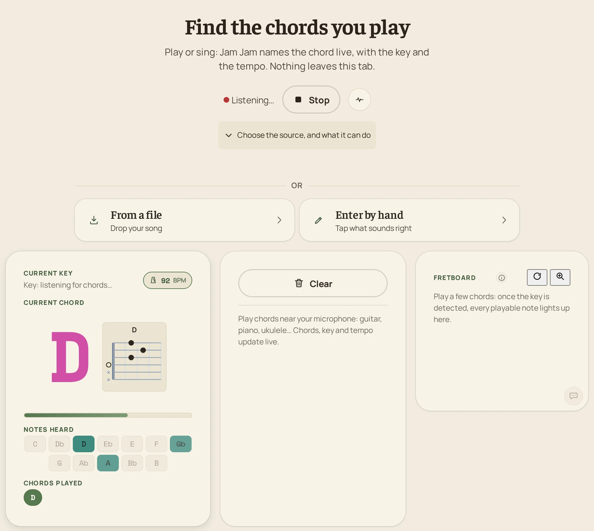

# Jam Jam, free chord, key and tempo detector

Jam Jam finds the chords, the key and the tempo of a song. Drop an audio file or play into the microphone, and you get time-stamped chords out of 168 (14 chord qualities across 12 keys), the key, the tempo, the song structure and, when the song is sung, synced lyrics.

**On the web, detection is free and unlimited in your browser, with no account.** Jam Jam also comes as an Android app and an iOS public beta.

  

## Try it

| | Link |
|---|---|
| Web tool (nothing to install) | <https://jam-jam.org/app/detection> |
| Presentation page | <https://jam-jam.org/detection/> |
| Android | <https://play.google.com/store/apps/details?id=com.jamjam> |
| iOS public beta (TestFlight) | <https://testflight.apple.com/join/fx95DYFE> |
| Machine-readable summary | <https://jam-jam.org/llms.txt> |

## What it does

- **Chords, with timestamps.** 168 chords: 14 qualities across the 12 keys.
- **Key and tempo** together with the chords. When the tempo found is double or half of the real one, it can be fixed in one tap.
- **Song structure.** Repeated passages are grouped into sections.
- **Synced lyrics** when the song is sung.
- **Inputs.** An audio file (mp3, wav, m4a, ogg, flac), the microphone, and on the web the sound of your computer or of a browser tab. You can also enter chords by hand.
- **Live or file.** Live listening shows the current chord, the notes heard and a chord diagram. File analysis returns the whole chord chart, which can be sent to the songbook.

  

## How detection works

For a file, the browser (or the app) runs this pipeline:

1. **Decode** the audio and mix it down to mono at 22,050 Hz.
2. **Compute a constant-Q transform** (144 bins).
3. **Run a chord model.** A BTC Transformer exported to ONNX classifies each frame into one of 170 output classes. A bidirectional variant is used for files, where the whole song is available. A causal variant, which only looks at the past, is used for live listening.
4. **Smooth and segment** the frame labels into time-stamped chords, then estimate the key from them and group repeated passages into sections.
5. **Track the beats** with Beat This! (small), another ONNX model, to get beats, bars and the tempo.
6. **Transcribe the lyrics** with a Whisper model when the song is sung.

On the web, the models run in a Web Worker through onnxruntime-web. If a browser cannot run the full pass, a simplified fallback recognises only triads and common sevenths, and the page says so.

Running in the browser is slower, and slightly less accurate, than the mobile apps, which use the on-device engine.

### Models

The model files are published, with SHA-256 checksums and licenses, in [**jam-jam-assets**](https://github.com/titouannwtt/jam-jam-assets). That repository keeps each file under a pinned release tag, so an older app version keeps working.

| Task | Model | Format | License, as stated in jam-jam-assets |
|---|---|---|---|
| Chords (files) | BTC-ISMIR19, bidirectional (`btc_model_170_ft.onnx`) | ONNX | Upstream code: MIT. These weights were trained for Jam Jam and their license is not stated: see upstream. |
| Chords (live) | BTC-ISMIR19, causal (`btc_model_170_causal.onnx`) | ONNX | Same as above. |
| Beats and tempo | [Beat This!](https://github.com/CPJKU/beat_this) small (`beat_this_small.onnx`), by Francesco Foscarin, Jan Schlüter and Gerhard Widmer (ISMIR 2024) | ONNX | MIT (code and published weights). |
| Lyrics (mobile apps) | [whisper.cpp](https://github.com/ggml-org/whisper.cpp) `base`, 5-bit quantized (`ggml-base-q5_1.bin`), converted from [OpenAI Whisper](https://github.com/openai/whisper) | GGML | MIT. |

On the web, lyrics are transcribed in the browser with a quantized Whisper `base` model run through transformers.js, from the same Whisper family.

The chord models are based on [BTC-ISMIR19](https://github.com/jayg996/BTC-ISMIR19), *A Bi-Directional Transformer for Musical Chord Recognition* (ISMIR 2019). The chord models were retrained on a validated corpus of real songs, and the evaluation figures (weighted chord symbol recall, per chord quality, per release) are published in the jam-jam-assets release notes rather than repeated here. The same repository also holds the SoundFonts and drum kits the app plays with.

## Privacy

- **Microphone audio never leaves your device.** On the web, it stays in the tab.
- **Files analysed in your browser stay in your browser.** Expect a few minutes per song, plus a one-off download of the models on the first run.
- **Files analysed on the Jam Jam server** (faster, and the lyrics come out better) are sent for the time of the analysis, then deleted: nothing is kept or reused. The server is hosted in France. If the server is free, it can take over from the browser to go faster. You can choose to stay local.
- Detection needs no account.

## Platforms

| Platform | Live listening | Audio file |
|---|---|---|
| Web, <https://jam-jam.org> | Yes (microphone, computer or tab audio) | Yes |
| Android | Yes | Yes |
| iOS (TestFlight beta) | No | Yes |

The web detection is free and unlimited in the browser.

## Other tools

Detection is one part of Jam Jam, a songbook for musicians:

- **Tuner**: 31 instruments and 79 tunings.
- **Online keyboard**: 142 sounds, 19 of them free, with MIDI keyboard support.
- **Songbook**: keep and edit your chord sheets, transpose them, export to PDF. Import from 27 tablature sites, from a PDF or a link, or from a photo on mobile.
- Available in 10 languages.

## API and developers

- [**jam-jam-api-examples**](https://github.com/titouannwtt/jam-jam-api-examples): runnable `curl`, JavaScript and Python examples for the Jam Jam REST API (`https://jam-jam.org/api/v1`), which turns music files, links and text into chord sheets, ChordPro, PDF, MIDI and MusicXML.
- Documentation: <https://jam-jam.org/developers/>
- Models and sounds: [jam-jam-assets](https://github.com/titouannwtt/jam-jam-assets)

## FAQ

### How do I find the chords of a song?

Open <https://jam-jam.org/app/detection>, drop an audio file (mp3, wav, m4a, ogg or flac), and choose whether to analyse it in your browser or on the server. The chord chart, the key and the tempo come out together. To find the chords you are playing instead, choose "Listen live" and play into the microphone.

### Is it free?

On the web, chord, key and tempo detection is free and unlimited in your browser, with no account. The Android app and the iOS beta are free to install.

### Does it work offline?

The mobile apps recognise chords on the device once the models are installed, so they can work offline. The web app has no offline mode: it needs a connection to load, and then calculates in your browser. The first run downloads the models (about 13 MB for chords, about 9 MB for the tempo), which are then kept in the browser.

### How do I find the key and the tempo (BPM) of a song?

Drop the file in the detection tool. The estimated key and the tempo in BPM are given together with the chords. If the tempo comes out at double or half of the real one, you can correct it in one tap.

### Is my audio uploaded?

Microphone audio is analysed on your device and never uploaded. A file is uploaded only if you let the Jam Jam server analyse it; it is deleted when the analysis ends. See [Privacy](#privacy).

## About this repository

This repository only presents Jam Jam: it has no application code. The Jam Jam name, logo and screenshots belong to the Jam Jam project. Model files and their licenses are in [jam-jam-assets](https://github.com/titouannwtt/jam-jam-assets).
